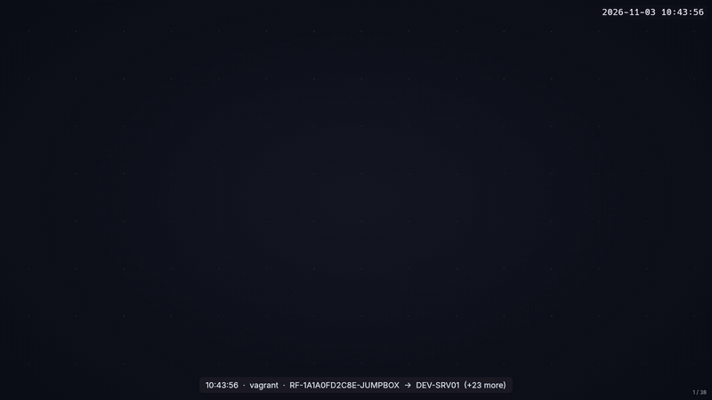

# Masstin

<div align="center">
  
  <br><br>
  <strong>Lateral movement tracker for anything.</strong>
  <br>
  Every login from every log you have, in one timeline. One statistical hunt over it. A window that shows who went where. One binary: no SIEM, no database, no plugins.
  <br><br>

  [](https://github.com/jupyterj0nes/masstin/releases/latest)
  [](https://crates.io/crates/masstin)
  [](https://www.gnu.org/licenses/agpl-3.0)
  [](https://github.com/jupyterj0nes/masstin/releases/latest)

</div>

<div align="center">
  
  <br>
  <em>An hour and a half of an intrusion in thirteen seconds. A jump box logs in to three servers with one account; an administrator hops from a server to the partner's domain controller, and from there into the other domain. Each connection draws itself at the moment it happened, with the account on the line. A five-host lab, parsed and hunted by masstin; the clock is the timeline's.</em>
</div>

## Three steps

1. **Give it the evidence.** Drop a folder of EVTX, a KAPE / Velociraptor / UAC triage, a disk image, Linux or macOS logs on the window (or run `parse-massive` in a terminal). Masstin says what it is, parses it with its progress bars drawn in the window, and opens the timeline: one CSV, the same columns whatever the source. [Parsing →](docs/parsing.md)
2. **Hunt.** `graph-hunt` tests every connection after the start of the investigation against what the network did before it, and keeps what survives a false-discovery-rate test. The only number you choose is the FDR; every finding comes with its reason in words. [graph-hunt →](docs/graph-hunt.md)
3. **Look.** Hosts drawn as the machines they are, the accounts on the lines, the findings glowing. Neighbourhoods, time-respecting paths and reach cones between hosts, the questions an analyst asks of a login graph, marks and notes written back into the CSV, a replay you can present and record. [The viewer →](docs/viewer.md)

https://github.com/user-attachments/assets/1f28b074-1fe7-43c8-868a-64053b33c00b

<div align="center">
  <em>The demo, 97 seconds: a case folder dropped on the window, the wizard saying what it holds, the parser's bars, the graph, the hunt and its report, the paths and the reach from the jump box, the replay. Filmed by masstin itself (Tools › Film the window), no hand on the mouse. <a href="resources/masstin-viewer-demo.mp4">MP4 to download</a>.</em>
</div>

## Quick start

Download the binary for your platform from the [Releases page](https://github.com/jupyterj0nes/masstin/releases/latest), or `cargo install masstin`. No runtime dependencies.

```bash
masstin                    # the window: drop the evidence on it, hunt and look from there
```

Double-clicking `masstin.exe` does the same. The viewer writes nothing where it runs: a timeline's saved views, story and notes live next to the CSV with its name, the recent list under the user's configuration folder ([where things are kept →](docs/viewer.md#where-things-are-kept)).

The same three steps from a terminal:

```bash
# 1. everything under the evidence folder (images, zips, triages, loose files) -> one timeline
masstin -a parse-massive -d /evidence/case-2026-03 -o timeline.csv

# 2. what happened after the cutoff that this network had never done before?
#    every row of timeline.csv gets its verdict (hunt, hunt_score, hunt_why); the report explains the findings
masstin -a graph-hunt-csv -f timeline.csv --investigation-from "2026-03-15 00:00:00" --report hunt.md

# 3. the graph, with the hunt's states on it; marks go back into the CSV
masstin -a view -f timeline.csv
```

Known-bad host or account? `--seed 10.10.1.50` on the hunt reconstructs the chain from it. Neo4j or Memgraph wanted anyway? `load-memgraph` / `load-neo4j` export the graph ([Graph databases →](docs/graph-databases.md)).

> **macOS first run:** if Gatekeeper blocks the binary, run `xattr -d com.apple.quarantine masstin-*` once.

## What it reads

| Source | What masstin takes from it |
|---|---|
| **Windows** | 36+ Event IDs across 14 providers (Security 4624/4625/4634/4648/4768/4769/4776/4778/5140/5145…, Terminal Services, RDP, SMB, WinRM, WMI, Sysmon 3, OpenSSH, Scheduled Tasks); UAL databases; MountPoints2 from NTUSER.DAT; Volume Shadow Copies; EVTX chunks carved from unallocated space. |
| **Forensic images** | E01, VMDK, VHD / VHDX, dd / raw, mounted volumes, images packed inside zips. NTFS and ext4 walked; BitLocker detected and reported. |
| **Linux** | `auth.log`, `secure`, `messages`, `wtmp` / `btmp` / `lastlog`, `audit.log`, binary journald. Session ends paired to their login, syslog times to UTC. |
| **macOS** | The Unified Log, as a `.logarchive` (read directly on any OS) or a `log show` JSON export: SSH and Screen Sharing logons. |
| **Triage packages and feeds** | KAPE, Velociraptor, UAC, Cortex XDR, plain zips and tarballs nested in each other; Winlogbeat JSON, Cortex XDR exports, Mordor / OTRF datasets. |
| **Anything else** | `parse-custom` with a YAML rule (csv, regex, key=value, JSON). Rules ship for Palo Alto, Cisco, Fortinet, Check Point, OpenVPN, Squid, Zscaler ZPA, Cloudflare Access. [Custom parsers →](docs/custom-parsers.md) |

Every source lands in the same CSV: 14 columns that describe the login and five that the hunt and the analyst fill. The columns are in [docs/csv-format.md](docs/csv-format.md), the full artifact list in [ARTIFACTS.md](ARTIFACTS.md).

## How the hunt decides

A connection is one origin logging in to one destination with one account on one day. Connections that already happened on a baseline day are habitual and never reported. For the new ones, what is new about the connection and what its origin did that day (first-time destination, an account the origin never used, a sweep of failures, a refused attempt followed by a login with another account, an account that belongs to another machine, a crossing between communities, a causal path through a pivot…) are measured against the baseline and combined into one empirical p-value per connection; Benjamini-Hochberg across the window controls the false discovery rate you asked for. [The statistics →](docs/graph-hunt-statistics.md)

<div align="center">
  
  <br>
  <em>The public Los Alamos set, no seed, no hint: 21 million logins read, 204 connections survive the 5 % false discovery rate, and the first rows are the red-team machine switching credentials on hosts it had never reached. The minutes of computation are cut out of the recording.</em>
</div>

| Case | What is known | What graph-hunt reports, no seed, no hint |
|---|---|---|
| **DFIR Madness "Szechuan sauce"**: 2 disk images, 5,916 rows, 2 days of logs | One external IP enters the DC over RDP and goes on to a workstation | 0 significant: with one baseline day there is no null to test against, and it says so instead of inventing a threshold. With that IP as `--seed`, the 4-hop chain with its certainties. |
| **LANL authentication set**: 21.3 M rows, 749 labelled red-team logins | Four red-team machines; 444 red-team connections in the window | 204 significant: 185 red team plus one unlabelled machine that failed on 47 hosts and then logged in with 7 new accounts. The first 83 rows are all red team; 0 significant on an incident-free period. |

## Documentation

| Topic | Where |
|---|---|
| The viewer: evidence in, filters, neighbourhoods, paths, marks, presentation, recording, filming | [docs/viewer.md](docs/viewer.md) |
| Every `parse-*` action, noise filtering, triage detection, carving, merge | [docs/parsing.md](docs/parsing.md) |
| graph-hunt: options, output columns, report, seeds, Sigma corroboration, detection quality | [docs/graph-hunt.md](docs/graph-hunt.md) |
| The statistics behind the hunt | [docs/graph-hunt-statistics.md](docs/graph-hunt-statistics.md) |
| The timeline's columns · artifacts and fields | [docs/csv-format.md](docs/csv-format.md) · [ARTIFACTS.md](ARTIFACTS.md) |
| Custom parsers (YAML rules) | [docs/custom-parsers.md](docs/custom-parsers.md) |
| Exporting to Neo4j / Memgraph, the Cypher catalogue | [docs/graph-databases.md](docs/graph-databases.md) · [Cypher queries](neo4j-resources/cypher_queries.md) |
| Every command-line option | [docs/cli-options.md](docs/cli-options.md) |
| Articles, in English and Spanish | [weinvestigateanything.com](https://weinvestigateanything.com/en/tools/masstin-lateral-movement-rust/) |

`masstin --help` lists every action and flag. [CHANGELOG.md](CHANGELOG.md) says what changed in each release.

## Roadmap

- macOS: smbd share connections, `system.log` / ASL text, the utmpx / wtmpx login databases, APFS disk images
- EVTX carving Tier 3 (template matching), unallocated-only scan, header tampering detection; Linux log carving
- More custom-parser rules (Juniper, SonicWall, Okta); per-rule `--validate`
- Official Velociraptor plugin

## About

Masstin is the Rust rewrite of [Sabonis](https://github.com/jupyterj0nes/sabonis), named after the [Mastín Leonés](https://en.wikipedia.org/wiki/Spanish_Mastiff), the guardian dog of the mountains of León. It builds on stable Rust with a plain `cargo build --release`. If you use it in research, [CITATION.cff](CITATION.cff) has the reference.

Licensed under the GNU Affero General Public License v3.0 ([LICENSE](LICENSE)).

**Toño Díaz** ([@jupyterj0nes](https://github.com/jupyterj0nes)) · [LinkedIn](https://www.linkedin.com/in/antoniodiazcastano/) · [weinvestigateanything.com](https://weinvestigateanything.com)
