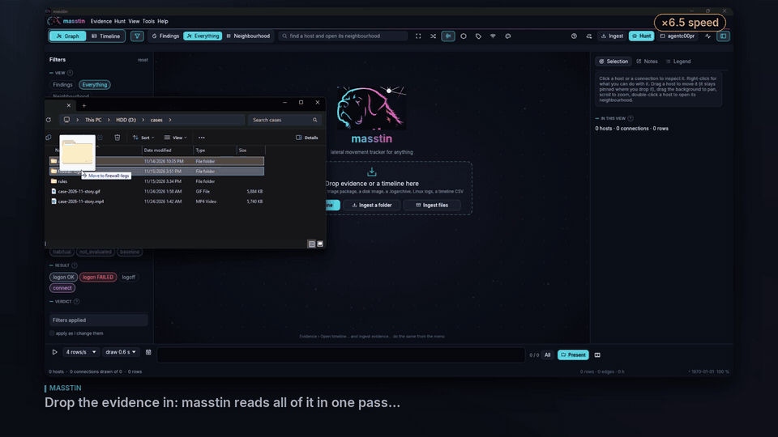
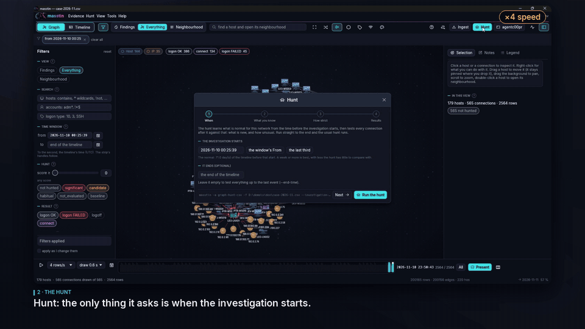

# Masstin

<div align="center">
  
  <br><br>
  <strong>Lateral movement tracker for anything.</strong>
  <br>
  Every login from every log you have, in one timeline. One statistical hunt over it. A window that shows who went where. One binary: no SIEM, no database, no plugins.
  <br><br>

  [](https://github.com/jupyterj0nes/masstin/releases/latest)
  [](https://crates.io/crates/masstin)
  [](https://www.gnu.org/licenses/agpl-3.0)
  [](https://github.com/jupyterj0nes/masstin/releases/latest)

</div>

<div align="center">
  
  <br>
  <em>A case folder dropped on the window and read in one pass. The network appears, the hunt lights up what this network had never done before, and from a suspect host everything it reached is marked. A lab case, real clicks, sped up where the badge says so.</em>
</div>

## From the evidence to the story

1. **Any evidence, as it comes.** Drag the case folder onto the window: disk images, cloud snapshots, KAPE / Velociraptor / UAC triages, loose EVTX, Linux and macOS logs, mixed as they came. Nothing to mount, nothing to convert. Masstin looks inside, says what it found, reads file systems, shadow copies and deleted logs straight from the images, and writes one timeline with the same columns whatever the source. From a terminal it is one action, `masstin -a parse -d <folder>`. [Parsing →](docs/parsing.md)
2. **It finds the intrusion for you.** No rules to write. Give `graph-hunt` the day the investigation starts: every connection after it is weighed against what the network did before, and what survives a false-discovery-rate test lights up, most unusual first, each finding with its reason in words. The only number you choose is the FDR. [graph-hunt →](docs/graph-hunt.md)
3. **How the attacker moved.** Hosts drawn as the machines they are, the accounts on the lines. Open a host's neighbourhood, ask for the time-respecting paths from one host to another or for everything a suspect host reached, and the route stands out of the whole picture hop by hop. The questions an analyst asks of a login graph are on a menu, and your verdicts and notes go back into the timeline. [The viewer →](docs/viewer.md)
4. **A video for your client.** Tell each step in your own words and masstin replays the intrusion connection by connection, with the clock and your captions, and records it as an MP4 or a GIF next to the evidence. *Tools › Film the window* records the window itself as you work. [Presentation and recording →](docs/viewer.md#presentation-and-recording)


https://github.com/user-attachments/assets/fe6a9609-1ff0-4661-9da4-8e2ab356270d


<div align="center">
  <em>The four steps in ninety seconds. The long version walks through every one of them, with guides and case walkthroughs, at <a href="https://weinvestigateanything.com/en/tools/masstin-lateral-movement-rust/">weinvestigateanything.com</a>.</em>
</div>

## Quick start

One file, no installer, no runtime dependencies. Get the one for your system from the [Releases page](https://github.com/jupyterj0nes/masstin/releases/latest).

### Windows

1. Download `masstin-vX.Y.Z-windows.exe`.
2. **Double-click it.** The window opens: drop your evidence on it, and ingest, hunt and look from there. No terminal needed.

If SmartScreen stops it the first time, *More info › Run anyway*.

The same from PowerShell, for scripts and servers:

```powershell
.\masstin-vX.Y.Z-windows.exe                                      # the window
.\masstin-vX.Y.Z-windows.exe -a parse -d D:\evidence\case -o timeline.csv
```

### Linux

1. Download `masstin-vX.Y.Z-linux`.
2. Make it executable and run it. On a desktop, the window opens, the same as on Windows:

```bash
chmod +x masstin-vX.Y.Z-linux
./masstin-vX.Y.Z-linux                                            # the window
```

On a server with no desktop, everything the window does is on the command line (below).

### macOS

Download `masstin-vX.Y.Z-macos-arm64` (Apple silicon) or `masstin-vX.Y.Z-macos-x86_64` (Intel), `chmod +x` it and run it. If Gatekeeper blocks it, run `xattr -d com.apple.quarantine masstin-*` once.

### From source

`cargo install masstin`, on stable Rust.

The viewer writes nothing where it runs: a timeline's saved views, story and notes live next to the CSV with its name, the recent list under the user's configuration folder ([where things are kept →](docs/viewer.md#where-things-are-kept)).

### The first three steps from a terminal

```bash
# 1. the evidence folder (images, zips, triages, loose files): masstin says what it found
#    and reads it all -> one timeline
masstin -a parse -d /evidence/case-2026-03 -o timeline.csv

# 2. what happened after the cutoff that this network had never done before?
#    every row of timeline.csv gets its verdict (hunt, hunt_score, hunt_why); the report explains the findings
masstin -a graph-hunt-csv -f timeline.csv --investigation-from "2026-03-15 00:00:00" --report hunt.md

# 3. the graph, with the hunt's states on it; marks go back into the CSV
masstin -a view -f timeline.csv
```

Known-bad host or account? `--seed 10.10.1.50` on the hunt reconstructs the chain from it. Neo4j or Memgraph wanted anyway? `load-memgraph` / `load-neo4j` export the graph ([Graph databases →](docs/graph-databases.md)).

## What it reads

| Source | What masstin takes from it |
|---|---|
| **Windows** | 37 Event IDs across 12 EVTX channels (Security 4624/4625/4634/4648/4768/4769/4776/4778/5140/5145…, Terminal Services, RDP, SMB, WinRM, WMI, Sysmon 3, OpenSSH, Scheduled Tasks); UAL databases; MountPoints2 from NTUSER.DAT; Volume Shadow Copies; EVTX chunks carved from unallocated space. |
| **Forensic images** | E01, VMDK, VHD / VHDX, dd / raw (split in segments too), cloud snapshots with no extension (known by their content), mounted volumes, images packed inside zips. NTFS, ext4 and XFS walked, LVM volumes included; BitLocker detected and reported. |
| **Linux** | `auth.log`, `secure`, `messages`, `wtmp` / `btmp` / `lastlog`, `audit.log`, binary journald. Session ends paired to their login, syslog times to UTC. |
| **macOS** | The Unified Log, as a `.logarchive` (read directly on any OS) or a `log show` JSON export: SSH and Screen Sharing logons. |
| **Triage packages and feeds** | KAPE, Velociraptor, UAC, Cortex XDR, plain zips and tarballs nested in each other; a Cortex XDR tenant read through its API, Winlogbeat JSON, Cortex XDR exports, Mordor / OTRF datasets. |
| **Anything else** | `-a parse --rules <rule>` with a YAML rule (csv, regex, key=value, JSON). Rules ship for Palo Alto, Cisco, Fortinet, Check Point, OpenVPN, Squid, Zscaler ZPA, Cloudflare Access. [Custom parsers →](docs/custom-parsers.md) |

Every source lands in the same CSV: 14 columns that describe the login and five that the hunt and the analyst fill. The columns are in [docs/csv-format.md](docs/csv-format.md), the full artifact list in [ARTIFACTS.md](ARTIFACTS.md).

## How the hunt decides

A connection is one origin logging in to one destination with one account on one day. Connections that already happened on a baseline day are habitual and never reported. For the new ones, what is new about the connection and what its origin did that day (first-time destination, an account the origin never used, a sweep of failures, a refused attempt followed by a login with another account, an account that belongs to another machine, a crossing between communities, a causal path through a pivot…) are measured against the baseline and combined into one empirical p-value per connection; Benjamini-Hochberg across the window controls the false discovery rate you asked for. [The statistics →](docs/graph-hunt-statistics.md)

<div align="center">
  
  <br>
  <em>The hunt in the window. It asks when the investigation starts and nothing else; what does not fit the network's own past lights up, most unusual first, each finding with its reason in words, and your verdict and note go into the timeline.</em>
</div>

| Case | What is known | What graph-hunt reports, no seed, no hint |
|---|---|---|
| **DFIR Madness "Szechuan sauce"**: 2 disk images, 5,916 rows, 2 days of logs | One external IP enters the DC over RDP and goes on to a workstation | 0 significant: with one baseline day there is no null to test against, and it says so instead of inventing a threshold. With that IP as `--seed`, the 4-hop chain with its certainties. |
| **LANL authentication set**: 21.3 M rows, 749 labelled red-team logins | Four red-team machines; 444 red-team connections in the window | 204 significant: 185 red team plus one unlabelled machine that failed on 47 hosts and then logged in with 7 new accounts. The first 83 rows are all red team; 0 significant on an incident-free period. |

## Documentation

| Topic | Where |
|---|---|
| The viewer: evidence in, filters, neighbourhoods, paths, marks, presentation, recording, filming | [docs/viewer.md](docs/viewer.md) |
| `-a parse` and every `parse-*` action, noise filtering, triage detection, carving, merge | [docs/parsing.md](docs/parsing.md) |
| graph-hunt: options, output columns, report, seeds, detection quality | [docs/graph-hunt.md](docs/graph-hunt.md) |
| The statistics behind the hunt | [docs/graph-hunt-statistics.md](docs/graph-hunt-statistics.md) |
| The timeline's columns · artifacts and fields | [docs/csv-format.md](docs/csv-format.md) · [ARTIFACTS.md](ARTIFACTS.md) |
| Custom parsers (YAML rules) | [docs/custom-parsers.md](docs/custom-parsers.md) |
| Exporting to Neo4j / Memgraph, the Cypher catalogue | [docs/graph-databases.md](docs/graph-databases.md) · [Cypher queries](neo4j-resources/cypher_queries.md) |
| Every command-line option | [docs/cli-options.md](docs/cli-options.md) |
| Articles, in English and Spanish | [weinvestigateanything.com](https://weinvestigateanything.com/en/tools/masstin-lateral-movement-rust/) |

`masstin --help` lists every action and flag. [CHANGELOG.md](CHANGELOG.md) says what changed in each release.

## Roadmap

- macOS: smbd share connections, `system.log` / ASL text, the utmpx / wtmpx login databases, APFS disk images
- EVTX carving Tier 3 (template matching), unallocated-only scan, header tampering detection; Linux log carving
- More custom-parser rules (Juniper, SonicWall, Okta); per-rule `--validate`
- Official Velociraptor plugin

## About

Masstin is the Rust rewrite of [Sabonis](https://github.com/jupyterj0nes/sabonis), named after the [Mastín Leonés](https://en.wikipedia.org/wiki/Spanish_Mastiff), the guardian dog of the mountains of León. It builds on stable Rust with a plain `cargo build --release`. If you use it in research, [CITATION.cff](CITATION.cff) has the reference.

Licensed under the GNU Affero General Public License v3.0 ([LICENSE](LICENSE)).

**Toño Díaz** ([@jupyterj0nes](https://github.com/jupyterj0nes)) · [LinkedIn](https://www.linkedin.com/in/antoniodiazcastano/) · [weinvestigateanything.com](https://weinvestigateanything.com)
