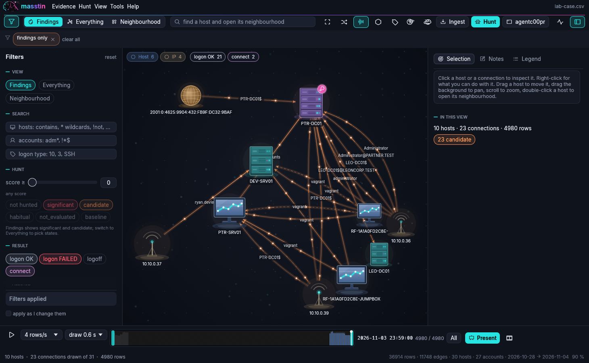

# The viewer: `masstin -a view`

The lateral-movement graph in a window of masstin's own, read straight from the timeline CSV. No database, no browser. Back to the [README](../README.md).

```bash
# the hunt's findings on a timeline (run graph-hunt-csv first so the rows carry their state)
masstin -a view -f timeline.csv

# open on a host's neighbourhood, inside a window of time
masstin -a view -f timeline.csv --focus SRV01 --start-time "2026-03-15 00:00:00" --end-time "2026-03-16 00:00:00"

# several timelines at once
masstin -a view -f dc01.csv -f srv02.csv
```

<div align="center">
  
  <br>
  <em>After the hunt: the Findings view of a five-host lab, the filter pane on the left, the inspector on the right, the time strip below.</em>
</div>

## What is drawn

A **host** is a piece of glass: a soft shadow, a gradient from a lit centre to a darker rim, a highlight, a thin bright rim, coloured by what the graph makes of it (slate blue for a workstation, teal for a server, violet for a domain controller, muted amber for an address outside the private ranges, sand for an address the hunt could not tie to a name). Four **node styles** (View > Labels and sizes): **machines** (the default: the host drawn as what it is, a monitor with its screen lit, a laptop, a rack server with its lights, a domain controller with its key badge, an antenna for an address, a globe for an external one, and database, cloud, router and phone from the catalogue; the lights breathe with motion on), **glass**, **icons** (the glass with a glyph in the middle) and **minimal** (a dot in a ring). A host can carry its own icon from a catalogue of twenty-five (right-click > Style of this host), whatever the style. A **connection** is a line from origin to destination with an arrowhead and the account written on it. Hosts are the machines graph-hunt sees: upper-case short names, an IP folded into the host name the same-login test gives it (the host lists its addresses in the pane and in the tooltip).

- **Width** of an edge grows with its number of events; **size** of a host with its traffic in the view.
- **Colour** of an edge is its result (logon OK grey, logon FAILED red, connect purple and dotted, logoff grey and dotted), unless the hunt has a word on it: `significant` red and thick, `candidate` orange. An edge fades in from its origin and is brightest at its destination, so the direction reads even before the arrowhead. A host touched by a significant connection gets a red ring and a slow red pulse; a candidate a faint orange one.
- **Halo**: a connection the analyst marked carries a halo (pink for suspicious and confirmed, green for benign).
- Two hosts with more than six accounts between them are drawn as **one edge** that says how many (a spray or a Kerberoast would otherwise be a fan of parallel curves).
- **Motion** (a checkbox in the bar, saved with the style): bright dots travel along the connections that matter, origin to destination (the findings, the glowing rules, whatever is hovered or selected), the significant hosts breathe, a hovered host gets a pulsing ring. Off, the picture is still; it costs nothing when nothing moves.
- Hovering or selecting something fades everything else out over a fraction of a second; a host that enters the view pops in; the camera glides to where it goes (Fit, zoom, a neighbourhood).

Drag a host to move it: it stays **pinned** where you drop it (a pin on its corner) and the rest of the graph settles around it; right-click it to **Unpin**, or the background to **Unpin all**. Drag the background to pan, scroll to zoom, double-click a host to open its neighbourhood. The force layout runs while warm and settles; when it does, the picture is **stretched to the window's shape** and framed, so a tall graph uses the sides and a flat one the height. **Fill the window** (the corners on the toolbar) does it again at any time; **Lay out again** starts the layout over. Captions that would sit on one another are left out until the view is zoomed in or the edge is lit.

### Many hosts

The layout is d3's: repulsion through a Barnes-Hut quadtree (a far cell counts as its centre of mass), springs on the links weaker on a busy host (1 / the smaller degree, so a hub's five hundred leaves do not crush it), a weak gravity, the picture recentred every tick, overlaps pushed apart on a hash grid. A tick over 3,000 hosts and 47,000 links costs about 8 ms. Drawing adapts to the crowd: beyond 2,500 edges on screen the unlit edges become straight segments in one mesh (findings keep their colour), small hosts become discs in one mesh, captions and halos go, and the detail comes back as you zoom in. Measured on a laptop: the 15 hosts of a lab at the display's rate; 600 hosts with 12,700 edges drawn at 48 frames a second settled and 40 while the layout runs; 3,000 hosts with 47,000 edges at 29 settled and 20 while the layout runs. **F1** shows the frame budget (hosts and edges drawn, layout, geometry, edges, hosts, frame, fps) at the bottom left.

## The window

The logo's dog and the wordmark in its cyan-to-magenta gradient at the top left (click the dog for About); the accent of the window is the logo's cyan. A menu bar (**Evidence**, **Hunt**, **View**, **Tools**, **Help**), a toolbar, the row of applied filters, the filter pane on the left, the canvas, the inspector on the right, the time strip and a status line.

- **Evidence**: open or add timeline CSVs, reload, **Ingest evidence…** (below), **Rows as a table…**, **Merge timelines…**, the timelines open now and the recent ones.
- **Hunt**: **Run the hunt on this timeline…** (below) and the score threshold.
- **View**: the three views, fit, lay out again, the panes, motion, shapes by role, sizes, colour by, captions, the style rules.
- **Tools**: paths and reach, questions, the story and its recording, **Open the case in agentc00pr**, the log of the last run.
- **Toolbar**: the filter pane toggle, the three views as one control, a quick search (a host name, Enter opens its neighbourhood), fit, lay out again, motion, shapes by role, rules; on the right questions, paths, **Hunt**, agentc00pr, the frame budget, the inspector toggle.
- **Applied filters**: every filter that narrows the view is a chip under the toolbar (`host: SRV*`, `score ≥ 13`, `2026-11-03 20:00 → 2026-11-04 00:19`, `findings only`, `one edge per event`…); the × on a chip removes that filter at once, *clear all* removes them all. No chips, no filters.
- **Right-click** a host: expand around, only this host, paths from or to here, pin, **style of this host** (name position, text size, box, size, colour), hide, a note, copy the name. A connection: open in the inspector, mark suspicious / confirmed / benign, a note, **style of this connection** (colour, width, dashes, glow, hidden, for every connection of that account; a folded edge lets you pick the account), hide the account, only it. The background: fit, lay out again, unpin all, Findings, Everything, back to the view, clear the selection, a note on the case.

## Evidence in

`masstin -a view` with no `-f` opens on a **welcome**: the dog, a drop zone, *Open a timeline*, *Ingest a folder*, *Ingest files*, and the recent timelines. Evidence goes into the window three ways: **drop it** anywhere (a timeline CSV opens, Ctrl adds it to the view; anything else goes to the wizard), the **Ingest** button on the toolbar, or Evidence › Ingest evidence….

The **wizard** has four steps. *Evidence*: a drop zone and Folder… / Files… pickers; as soon as something is given masstin looks at it (bounded: twelve levels, sixty thousand entries, eight seconds) and says what it found as chips (EVTX, UAL databases, triage packages by kind: KAPE, Velociraptor, Cortex XDR, UAC; disk images; Linux logs by family; logarchives and `log show` exports; Winlogbeat JSON; timelines; other archives) and what it concludes: *Windows evidence → parse-windows*, *A disk image → parse-image*, *An evidence folder → parse-massive*, *Linux logs*, *macOS logs*, *Winlogbeat JSON*; timelines alone open as they are. When it cannot tell (Windows and Linux side by side, archives of no known layout, nothing it recognises) it says so and the next step asks. *Parser*: the six parsers as cards, the recommended one marked; you can always pick another. *Timeline*: the CSV to write (next to the evidence by default), whether it opens here (instead of or added to what is open), as a table, and / or with the system's CSV application; the command line, the same one for a terminal or a script. *Run*: masstin runs as a child process and the console's own progress is drawn here: the phases (`[1/3] Searching…`, `[2/3] Processing…`, `[3/3] Writing…`) with a tick as each ends, the bar with its count and the file under way, the spinners, the `=>` results, and the closing summary (artifacts parsed, events collected, time). *Stop* kills the child. When it is done: Open here, As a table, System's CSV app, Show in folder, Parse more.

**Rows as a table** (Evidence menu, or the wizard) has two faces. *Graph columns*: the rows the graph draws (those with an origin) in time order, in the viewer's columns (time, origin, destination, account, type, event, result and the hunt's word, score and reason), with a find box over hosts and accounts. *CSV · 19 columns*: every row of the files, the ones without an origin too, in the timeline's own 19 columns as they are written (`time_created` … `notes`), in the files' order, with a find box over the whole row. Both are drawn on demand, so a million rows scroll like fifteen; buttons open each file with the system's application or show it in its folder.

For scripts, `MASSTIN_VIEW_AUTO` takes `ingest=<path>` (the wizard on that evidence), `ingest` (the wizard), `ingest-step=N` (one of its four steps), `out=<csv>`, `ingest-go`, `ingest-stop`, `drop=<path>` / `drop+=<path>`, `table` and `table-csv` (the table in the file's 19 columns).

## Filters

The pane on the left (the funnel on the toolbar hides it). **Apply filters** at the bottom applies the pane; *apply as I change them* applies pills at once and text fields when you pause; Enter in a field applies too.

| Section | Meaning |
|---|---|
| View | **Findings**: the connections the hunt marked `significant` or `candidate`. **Neighbourhood**: the hosts within *hops* of the host(s) named. **Everything**: the other filters alone decide |
| Search | hosts, accounts, logon type: `contains` by default; `*` wildcards (`adm*`, `*$`); `=name` exactly that name; `!` negates; several separated by commas (`ws*,!ws09`) |
| Hunt | **score ≥**: `hunt_score` at least this (13 is one in twenty, 30 one in a thousand, 60 one in a million); the state pills (fixed to significant + candidate in Findings) |
| Result, Verdict | pills |
| Grouping | **Group accounts** (one edge per origin, destination, account and result; a pair with more than six accounts becomes one edge that says how many), **One edge per account** (never folded), **One edge per event** (every row its own curve, for a tight window) |
| Limit | connections drawn, the most pressing first (significant, then candidate, then by number of events); the status line and the inspector say when it was reached |
| Style | **View › Style…** (or the tag on the toolbar): the **mode** the hosts are drawn in, *realistic* (the machines shaded, with a shadow and their lights), *icons* (clean tiles with a glyph, like a network diagram), *arcade* (a video game: the machines as 16 × 16 pixel sprites with blinking lights, names in an 8-bit face, a starfield with parallax, scanlines, square bullets along the connections), *glass* or *minimal*; host size, bigger when there are few of them, size by traffic; where the names go, their size and box; the connections' width and opacity, curved or straight, arrowheads, glow on the findings, and when the **captions** are written on the connections: *when not crowded* (the default: while no more connections are on screen than the figure beside it, 80 unless you change it, the edge longer than 90 px and the zoom above 60 %; a caption that would sit on another is left out, which is why zooming in brings them back: fewer connections stay on screen), *always* (every connection, whatever the crowd, the zoom or the overlap) or *only on hover*; the lit and selected connections carry theirs in every mode; the canvas's grid, spotlight and motion. All of it saved with the view |
| Saved filters | yours, by name, and the built-in ones (RDP only, network logons, SSH, admin accounts, service accounts, without machine accounts, failures and touches, marked by the analyst, last 24 hours); **Save the current filter…** keeps the filter, the style *and*, when the box is ticked, **the arrangement** (where every host is on the canvas) under a name in `<timeline>.views.json`, next to the timeline; picking the filter puts the hosts back in their places, pinned, and hosts it did not know settle around them (*Lay out again* frees them); the trash on a saved filter asks before deleting |

The **time window** is set to the second in the pane's *Time window* section, **From** and **To**: type or paste `YYYY-MM-DD HH:MM:SS` (a date alone takes the whole day, From its first second and To its last; `HH:MM` the whole minute; empty: no bound; a text that does not read stays red and changes nothing), or open the **calendar** beside each field: a month at a time, the days shaded by how many events they hold, the hour, minute and second under it, *00:00:00*, *23:59:59*, the day's *first event* and *last event*, and *start / end of the timeline* to drop the bound. The times are the timeline's (UTC). The handles of the **time strip** at the bottom (below) and the chips show the same window and follow one another.

## Style

In the View menu and on the toolbar:

- **Colour by**: result (the default: logon OK grey, FAILED red, connect purple, logoff grey, with the hunt's red and orange on top), account (one colour per account, Neo4j's palette), logon type, hunt state, verdict. The chips at the top left list the categories in the view with their counts.
- **On edges**: what is written on an edge: the account, the first time, the logon type, account + time, the number of events, or nothing.
- **Shapes by role**: hexagon for a domain controller (it receives Kerberos ticket traffic, 4768 / 4769 / 4770 / 4771), rounded square for a server (mostly a destination), circle for a workstation, diamond for an address outside the private ranges; colours follow.
- **Hosts / Edges / Text**: scales.
- **Account and host colours**: coloured by account, the legend chips over the canvas are buttons: click one to pick that account's colour (a palette, or any colour); right-click a host or a connection for *Colour this host…* / *Colour <account>…*. These are style rules, saved with the style.
- **Labels and sizes** (View menu, or the tag on the toolbar): where every host's name goes (**auto**: inside when it fits readably, under it otherwise; **inside**; **band**: a band across the host, wider than it, like a road sign; **below**; **above**), the text size, a box behind the names and its colour, host size by traffic or not, the host and edge scales. Right-click a host › *Name, size and colour of this host…* sets the same for that host alone (its own name position, text size, box, size and colour), kept as a style rule on its exact name (`=NAME`) that wins over the global setting; *Back to the global settings* removes it.
- **Rules**: the style rules window. A rule is a field (host, account, logon type, event id, result, hunt, verdict) and a pattern (same syntax as the filters; empty matches everything), then the look it gives: colour, edge width, host size, shape, dashed, glow, hide. The first rule that matches wins; rules on host and hunt also apply to hosts. Buttons add the usual ones: one account in colour, hide machine accounts, fade what was marked benign, domain controllers as hexagons. Rules are saved with the style.

## Paths, cones and questions

**Paths…** finds the time-respecting paths between two hosts: a chain of logins where every hop happens after the previous one and no later than the gap allowed (hours; 24 by default), no host entered twice, up to a number of hops, inside the bar's time window. Hops are successful logons by default; failures, touches and logoffs can count too, and machine accounts are left out unless asked. The paths come shortest first, each as `A -(account HH:MM)-> B -(…)-> C`; clicking one draws it alone, the hosts in columns by hop with the time of each arrival. *Reach from origin* draws the earliest-arrival cone (every host a chain of logins could have reached from the origin, with the hop and the time it was first reached); *Ways into destination* the same backwards. *Paths from here* / *Paths to here* on a host fill the form. *Back to the view* returns to the filter's graph.

**Questions…** answers, over the rows of the current view: the origins reaching the most destinations, the destinations reached from the most origins, the accounts used from several origins, the connections where failures were followed by a logon, the hosts and accounts seen latest for the first time, and the centrality of every host (PageRank, betweenness, distinct in / out). Click a host to open its neighbourhood.

These are the questions the Cypher catalogue of the Neo4j export used to answer (`neo4j-resources/cypher_queries.md`), without a database.

## The inspector

Three tabs on the right.

- **Selection**. A **host**: its names, events in and out, its notes, every connection it has in the view (click one to open it), *Expand around*, *Only this host*, *Paths from here*, *Paths to here*. A **connection**: the account(s), result, number of events, first and last time, logon types and event IDs, the hunt's state with its score (0 to 100, how rare: 30 is one in a thousand) and explanation, the mark, and the rows behind it (first 300) with their event columns. Nothing selected: what is in the view, by state and verdict.
- **Notes**: the notes of the case (on a host, on a connection, or free), with the time they were written and a way to delete them, then every row of the timeline that carries a verdict or a note, click to open its connection.
- **Legend**: what the colours, rings, halos and widths mean.

## Subnets

The toolbar's antenna (or View › Subnet regions) groups the hosts of the view by where they sit on the network: **Tools › Subnets…** takes your CIDRs with a name (`10.10.0.0/24  servers VLAN 10`), and, when *auto* is on, every other host with an address gets the group of its /24. A host joins a group through the addresses it is known by (its own names, the address the hunt or you merged into it). Each group pulls its hosts together in the layout and pushes the other groups away, and is drawn as a soft region in its colour behind them with its name on top. The named subnets live in `<timeline>.views.json`.

The layout shares the window out: the distance between hosts comes from the room there is and the number of hosts, and the picture stretches along the window's long side, so a small graph spreads over the canvas instead of huddling in the middle.

## Merging hosts

The same machine often comes as an address in one log and as a name in another. The hunt folds an address into a name by itself when the same-login test allows it; for the rest, **right-click a host › Merge with another host…** (pick the other from the list), or select a host and right-click the other › **Merge with <host>…**. The window asks **which name stays**; the two become one node, every connection follows, the other name stays among the host's names in the inspector (with an undo next to it), and a note in the case says the host is a merge of the two. **Tools › Merged hosts…** lists the pairs, undoes any, adds one by name. The timeline CSV is not changed and keeps both names: the pairs live in `<timeline>.views.json` next to it, so they survive sessions and travel with the case.

## Marks and notes

A **verdict** (suspicious, confirmed, benign, or clear) with notes goes on the rows of a connection, into the `verdict` and `notes` columns of the timeline CSV (the file is rewritten through a temporary copy and renamed over the original). When a drawn edge stands for several rows, **the viewer asks**: the whole block (every row, every account folded into it) or only the rows you tick in the list. A case tool reading the same CSV sees the marks; the viewer reloads a file another program changed (**Reload** forces it).

A **note** on a host, on a connection or on the case itself has no row to live in: it goes to `<timeline>.notes.json` next to the timeline, with its time, where agentc00pr can read it too. Right-click, or the Notes tab.

## The time strip

The strip at the bottom is the whole timeline's events over time (a bar every three pixels, log scale, red where a significant connection falls), with the **window the filter selects as a bright band between two handles**. Drag a handle to narrow the window: that *is* the From / To filter, and the chips and the fields follow. The **calendar** button at the strip's left opens the same From / To fields in a window of their own, applied as they change, for when the pane is closed. Double-click frees the whole timeline. The white line is the **replay head**: drag anywhere else to scrub, **Play** runs the rows of the view in time order at the chosen speed, **All** shows everything again. The speed is **by rows** (1 to 250 rows of the view a second, whatever their times, or a number of your own) or **by the clock** (1 minute to 1 week of the timeline a second, or your own minutes a second: a quiet hour takes as long as a busy one, so the rhythm of the intrusion shows). When the head reaches a connection it **draws itself from the origin to the destination** over the seconds chosen next to the speed (instant to 4 s; several in one step follow one another), and a host reached for the first time pops in when the line gets there. Hover for the time under the pointer.

## The hunt, from the window

**Hunt** on the toolbar (or the Hunt menu) runs `graph-hunt-csv` on the timeline(s) open: the start of the investigation (prefilled with the window's From, or the last third of the timeline), an optional end, alpha. It runs as a child masstin with the same command line you would type, its output in a log window, and while it runs the mastiff of the logo is on the scent in the middle of the canvas and a sweep crosses it. When it ends the timeline is read again, the view switches to Findings and **the findings appear one after another in time order, each with a flash**; then **the summary** opens: rows by state, the rarest connections with their scores, the spread of scores, and the score threshold with one-click bars (one in twenty, one in a hundred, one in a thousand) that apply at once. The slider in the filter pane does the same at any time. The verdicts and notes already written are kept. *Tools › Log of the last run…* brings the log back.

## Presentation and recording

**Present** plays the view as a story, full window: each connection draws itself from origin to destination in its turn, the host it reaches pops in, a clock shows the moment, a caption at the bottom says what happened (`14:54:24 · admin-hacker · 10.23.123.11 -> ROOTDC1 (+9 more)`), a counter says where you are. Space pauses, Left / Right step, Home restarts, Esc leaves.

**Story…** is the editor, saved as `<timeline>.story.json` next to the timeline:

- a step is one row, or every row within *group rows within* seconds of the first (a spray over twenty hosts in three seconds is one step, not twenty);
- **timing**: the same seconds per step, or the real gaps compressed by a factor and clamped between a minimum and a maximum (so two days between two hops are felt without waiting);
- a **pause on significant** connections, a **hold** at the end, **fade older** edges, the clock, the caption and the counter on or off, a **title**;
- **anonymise**: HOST-01, user-02, 10.x.x.3, consistent through the story, for a talk;
- **per step**: its own seconds, a pause after it, its own caption, skip, emphasis (a glow and a framed caption). Click a step's number to see the graph at that moment.
- **logo**: an image of yours (PNG with transparency, JPEG, WebP, BMP, GIF) on the presentation and so on the recording, in one of six places (top or bottom, left, centre or right), as wide as you say (a share of the window's width) and as opaque (lower for a watermark); *also on the window* keeps it on the canvas outside the presentation. A bottom logo stays above the caption, a top-centre one pushes the title down.
- **stretches**: parts of the timeline at a speed of their own, for the recording and the presentation alike. Each has a start and an end (`YYYY-MM-DD HH:MM`, either side open when empty) and a timing: the same seconds per step, or by the clock in minutes of the timeline a second. The first stretch a step falls in sets its timing; steps outside every stretch take the global one, and a step's own seconds still win. *Add a stretch* starts one over the window the filter selects. So the week of nothing goes by in two seconds, the hour of the intrusion step by step, and the exfiltration slower still.

**Cinematic** (a switch in Record… and in the Story window; Present shows the same) is the look for a client, each piece of it optional:

- **focus**: while a hop draws, the rest of the picture dims; its two hosts and its line stay lit, a short ping leaves the origin, and a ring runs out of the destination as the line arrives (red when the hunt marked the hop). The camera does not move: the eye is led, not dragged.
- **footprint**: the hosts already reached keep a warm trace, so the spread is visible at a glance.
- **clock**: a card top right with the date, the time and the counter. The time **rolls** from the hop before while the line draws, at the story's pace, so a quiet week and a busy minute are felt; under it the pace (*a hop every 0.8 s*, *time ×600 · 10 min/s*) and, when a stretch changes it, *» faster* or *« slower* for a moment. A jump in the timeline (three hours, or three times the story's usual gap) is named at the top while the line draws: *2 days 3 h later*.
- **lower third**: the caption bottom left, sliding in with the hop: the account in the accent colour, origin → destination, a tag with the hunt's word (*significant*, *candidate*) or your verdict, the time and the logon under, and your note on that connection when you wrote one.
- **bar**: the incident's span along the bottom, a tick a day, the significant hops as red dots, the head where the story is.
- **cards**: a title card before the story (your logo, the title, the span, the counts; 3.5 s) and a summary after it (hosts reached, accounts, connections, the span, the significant hops; 7 s).
- **colour**: the client's colour for all of it instead of masstin's amber, from a picker or six presets, next to their logo.

**Record…** writes the story as it is shown: every frame is a screenshot of the window while the story plays. The dialog has everything in one place: the **title** and the **logo** drawn on the frames (the same the presentation shows: the image, its corner, width and opacity), the **format** (**GIF**; **MP4** when `ffmpeg` is on the PATH, H.264 that plays in PowerPoint, Keynote and browsers; **PNG frames** in a folder), the **quality** (*small file*, *balanced*, *best*: a GIF's colours and how small a change it redraws, an MP4's compression), the **size** (this window, 1280 x 720, 1600 x 900 or 1920 x 1080; the window is resized for the recording and put back after), the **frames a second** (a GIF's clock ticks in hundredths of a second, so for a GIF it offers 10, 20, 25, 33 and 50, the rates that keep time) and **where the file goes**: `<timeline>-story.<ext>` next to the case or the timeline, or wherever *Change…* says. Under them, **about how big the file will be**, a range measured on recordings at those settings (what moves on the picture decides where in it the file lands). The settings are saved with the story. While it records the window's title counts the frames, and **Esc stops the recording and keeps what was recorded**. A GIF frame stores only the pixels that changed since they were last drawn, with a palette of its own (the region's colours as they are when they fit, quantised otherwise), and a still frame lengthens the one before: a story of seventy connections at 720p and 20 frames a second is 4.7 MB balanced (4.0 MB small, 6.4 MB best) where the same GIF was 350 MB; as an MP4 it is 1.8 MB. The MP4 is streamed into ffmpeg as the frames come, so no frame files are written first.

**Film the window** (Tools menu) records the window as you use it, in real time, until *Stop filming*: the ingest wizard with its bars, a hunt, the paths, a presentation, whatever happens on it, as an MP4 next to the timeline (through `ffmpeg`'s standard input, so no frame files; a GIF when ffmpeg is not on the PATH). A frame is taken whenever one is due at 20 a second; when the window stalls, the film holds the last frame for as long as the stall lasted, so its clock stays the wall's. The demo video in the README was filmed this way, by the autopilot below.

## Where things are kept

Nothing is written where the binary runs. The viewer keeps:

- **in a case file**, when there is one: `<name>.masstin`, wherever you put it. **Evidence › Save as a case…** writes one from what is open (the timelines it names, and everything below that would go next to them); **Evidence › Open case…**, a `.masstin` dropped on the window, the recent list, or `masstin -a view --case D:\casescme.masstin` open it again. `--case` with `-f` starts the case on those timelines when the file is not there yet (taking what is already next to them, without writing there); a `.masstin` given to `-f` is taken as the case. While a case is open **nothing is written next to the timelines**, so the evidence share stays as it was, and the recordings and films go next to the case file. The case names its timelines by their full path; when a case and its timelines are moved together, they are found next to it. Opening another timeline leaves the case; adding one to the view keeps it in the case. The case file is JSON: `timelines`, `views` (as the views file below), `story`, `notes`.
- **next to the timeline**, without a case, with its name: `<timeline>.views.json` (the saved filters with their style and arrangement, the style in use, the merged hosts, the subnets), `<timeline>.story.json` (the presentation) and `<timeline>.notes.json` (the notes on hosts, connections and the case). Copy the CSV with its three side files and the case travels whole; delete them and the viewer starts clean on that timeline. The marks (`verdict`, `notes`) are in the CSV itself, case or no case, and so is what a hunt run from the window adds: to leave a share untouched, work on a copy of the timeline.
- **the recent timelines and cases** in `recent.json` under the user's configuration folder: `%APPDATA%\masstin\` on Windows, `$XDG_CONFIG_HOME/masstin/` or `~/.config/masstin/` elsewhere. That is the only thing kept per user.
- **scratch**: a timeline written for the welcome and a film started with nothing open go to `masstin/` under the system's temporary folder.

A window's size and position are not remembered; a timeline ingested from the window is written where the wizard's Timeline step says (next to the evidence by default).

## Driving it from outside

`MASSTIN_VIEW_AUTO` runs actions one per second once the window is up, for demos and tests: `present`, `story`, `record-dialog`, `cinematic` (the switch), `seek=SECONDS` (the presentation at that second, still), `rules`, `fit`, `questions`, `paths=A:B[:gap_h]`, `cone=A`, `record=FORMAT:FPS:SIZE[:QUALITY[:FILE]]` (`gif` / `png` / `mp4`; size `0` the window, `1` 720p, `2` 1080p, `3` 1600 x 900; quality `small` / `balanced` / `best`; the file, or the folder of PNG frames), `film=FORMAT:FPS:SIZE[:file]` (film the window from here on; `cut` stops it, `quit` waits for it), `close` (shut the windows open: wizard, hunt report, paths, story, table; leave a presentation), `from=` / `to=` / `host=` / `user=` (the filter pane's fields, applied at once), `results=ok+fail+connect+logoff` (the result pills), `shot=file.png` (a screenshot of the window), `hunt=YYYY-MM-DD HH:MM:SS` (run the hunt from that start), `all=LIMIT` (the Everything view with that limit), `select=HOST`, `zoom=F`, `style` (the Style window), `when` (the time window), `when-cal=pane:0|pane:1|strip:0|strip:1` (the calendar of that From / To), `captions=auto|always|hover`, `captions-limit=N`, `hud`, `motion`, `size=WxH` (the window's size), `bench=N` (times the next N frames with the layout heated and prints the figures on stderr; `bench=N:cold` as it is), `wait=SECONDS` and `quit`. `MASSTIN_VIEW_AUTO="record=gif:15:1,quit" masstin -a view -f timeline.csv` records the story at 720p and closes; `MASSTIN_VIEW_AUTO="all=5000,wait=5,shot=big.png,bench=120,wait=10,quit"` is how the figures above were taken. `MASSTIN_VIEW_DEBUG=1` prints what the viewer does on stderr; `MASSTIN_VIEW_HUD=1` opens with the frame budget shown.

## Remote desktops, servers and machines without a GPU

With a GPU the window is drawn by OpenGL (through `glow`). A remote desktop session, a VM or a server without a GPU driver has none: there Windows offers only its generic OpenGL 1.1 driver (too old for the viewer) and Direct3D's WARP, both the CPU emulating a GPU, and slowly (WARP took 155 ms a frame over RDP on a two-core server, six frames a second at 82 % of the CPU).

So, before the window opens, the viewer looks: in a **remote desktop session**, or when the only display adapter is **Windows' basic one**, it draws with **its own CPU rasteriser** instead, and the console says so (`Renderer: software, drawn by the CPU (a remote desktop session: no GPU to draw with)`). The rasteriser is made for this kind of picture: it keeps every piece it has drawn and only redraws the tiles that change, with SSE4.1 / AVX2 / NEON chosen for the CPU it runs on; the frame goes to the system as a plain bitmap, which a remote desktop carries well. It is egui_software_backend's rasteriser by DGriffin91 (MIT OR Apache-2.0), brought into masstin and ported (`src/view/soft/`), in a window loop of masstin's own (`src/view/softwin.rs`).

Measured over RDP on that two-core server, a lab of fifteen hosts, 1460 x 900:

| | WARP | masstin's rasteriser |
|---|---|---|
| CPU with the window still | 0 % | 0 % |
| CPU drawing every frame | 82 % | 43 % |
| Frames a second | 6 | 29 (capped at 30) |

- **`--renderer glow`** or **`--renderer software`** (or `MASSTIN_VIEW_RENDERER`) picks by hand; software works on any machine, Linux and macOS included.
- **Light mode.** Drawn by the CPU, or when ninety frames with motion on average under twelve a second, the viewer turns motion, the glow, the dot grid and the spotlight off and says so in the status line; View › Style turns any of them back on, `MASSTIN_VIEW_LIGHT=1` asks for it from the start. In light mode nothing animates: the layout settles in the first frame, the camera jumps instead of gliding, a hovered host lights at once, and **the window draws only when something changes**, so a server reached by RDP is idle while the picture is still. The software window draws thirty frames a second at most.

Help › About says what is drawing the window (the OpenGL renderer and version, or the software rasteriser and its instruction set). **F1** shows the cost of a frame (the real time between two frames, split into masstin's part and the rendering's, and the frames a second); while it is on it keeps the window drawing, to measure. `MASSTIN_VIEW_DEBUG=1` logs the frames drawn every two seconds, and in the software window where each frame's time goes (ui, tessellation, raster, presentation).

## Building without it

The viewer is behind the `ui` feature, on by default. `cargo build --no-default-features` gives a parser-only binary without the window stack.
